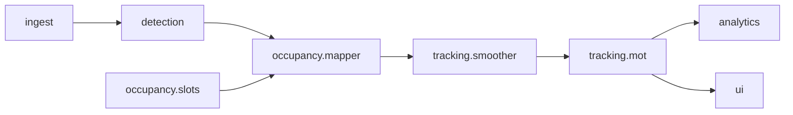

# Kiến trúc

**Trạng thái:** Sẵn sàng triển khai  
**Phụ thuộc:** 00-overview.md

## Thành phần

## FrameContext (một luồng dữ liệu)

| Trường | Kiểu | Mô tả |
|--------|------|--------|
| `frame_id` | int | Chỉ số frame tăng dần |
| `timestamp_ms` | float | Thời điểm capture |
| `image` | ndarray BGR | Frame thô |
| `detections` | list[Detection] | Sau detector |
| `slot_states` | dict | Sau smoother |
| `tracks` | list[Track] | Sau MOT |
| `fps` | float | FPS hiển thị (làm mượt) |

## Luồng xử lý

MVP: một thread (capture → infer → logic → render). Hàng đợi depth 1: bỏ frame nếu inference chậm hơn capture.

## Hợp đồng module

- **ingest:** sinh `FrameContext` chỉ có ảnh.
- **detection:** `DetectorProtocol.detect(image) -> list[Detection]`.
- **occupancy:** load JSON slot; map detection → slot ID.
- **tracking:** bỏ phiếu theo slot + IoU track toàn cục.
- **analytics:** cập nhật KPI khi đổi trạng thái.
- **ui:** vẽ overlay + panel từ context.

Pipeline modular mở rộng: xem [PIPELINE_ARCHITECTURE.md](PIPELINE_ARCHITECTURE.md).

## Checklist review

- [x] FrameContext đã định nghĩa
- [x] MVP một thread
- [x] Ranh giới module
