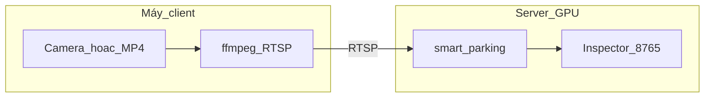

# Triển khai Server + Client

> **Triển khai chính:** [SCENARIO_B_LAPTOP_CLIENT.md](SCENARIO_B_LAPTOP_CLIENT.md) — **Server GPU** + **laptop client** (webcam hoặc **video MP4** qua RTSP).

Pipeline chạy trên **server**; **client** chỉ cung cấp video (RTSP / file copy).



## Chọn kịch bản

| ID | Mô tả | Client | Server |
|----|--------|--------|--------|
| **A** | Edge — tất cả trên một máy | Camera + GPU + app | Không dùng |
| **B** | Tập trung — **khuyến nghị** | Laptop phát RTSP | GPU + `rtsp://client/...` |
| **C** | File trên server | `scp` video | `data/*.mp4` |

---

## Mạng

| Cổng | Hướng | Dịch vụ |
|------|--------|---------|
| 8554/TCP | Laptop → LAN | RTSP (MediaMTX) |
| 8765/TCP | Server (local/VPN) | Pipeline Inspector |
| 8767/TCP | Server (LAN) | Inspector — config hiển thị camera |
| 8768/TCP | Server (LAN) | Inspector — config DETR |
| 22/TCP | Quản trị | SSH |

RTSP chỉ trong VLAN. Inspector remote qua SSH tunnel.

### Mở Inspector ra LAN

Mặc định `inspector.host: 127.0.0.1` (chỉ máy server). Các config
`configs/deploy/server*.yaml` đã đặt `0.0.0.0` để máy khác trong LAN
mở dashboard được:

```bash
# trên server (192.168.100.239)
python -m smart_parking --config configs/deploy/server.detr.yaml

# từ máy khác trong LAN
xdg-open http://192.168.100.239:8768/       # dashboard (GPU/RAM + cảnh báo)
curl http://192.168.100.239:8768/api/metrics
curl http://192.168.100.239:8768/api/system   # GPU/RAM/CPU máy server
curl http://192.168.100.239:8768/api/alerts   # cảnh báo gần đây
```

Lưu ý: Inspector **không có xác thực** — chỉ mở trong LAN tin cậy, không
port-forward ra Internet. Muốn thu hẹp lại thì đổi `host` về `127.0.0.1`
và dùng SSH tunnel: `ssh -L 8768:127.0.0.1:8768 ubuntu@192.168.100.239`.

---

## Kịch bản A — Edge (một máy có GPU)

```bash
sudo bash docs/setup/ubuntu-gpu.sh
bash scripts/setup_client.sh --role edge --install-app
source .venv/bin/activate
pip install -e ".[dev,inspector]"
python scripts/verify_gpu_ready.py
python -m smart_parking --config configs/deploy/edge.yaml --source webcam:0
```

Config: [`configs/deploy/edge.yaml`](../../configs/deploy/edge.yaml).

---

## Kịch bản B — Chi tiết

Xem [SCENARIO_B_LAPTOP_CLIENT.md](SCENARIO_B_LAPTOP_CLIENT.md).

Tóm tắt:

**Laptop:** `bash scripts/client_laptop_start.sh webcam` hoặc `video /path/demo.mp4`  
**Server:** `configs/deploy/server-rtsp.yaml` → `server.local.yaml` + `bash scripts/server_start_rtsp.sh`

---

## Kịch bản C — File trên server

```bash
scp parking_demo.mp4 user@SERVER:/opt/smart-parking/data/
python -m smart_parking --config configs/deploy/server-file-local.yaml
```

---

## Systemd (tùy chọn)

```bash
sudo cp deploy/systemd/smart-parking-server.service /etc/systemd/system/
sudo systemctl enable --now smart-parking-server
```

Client: `deploy/systemd/rtsp-publish.service`

---

## Checklist sau setup

| # | Client / Laptop | Server |
|---|-----------------|--------|
| 1 | `v4l2-ctl` hoặc file MP4 OK | `nvidia-smi` OK |
| 2 | `ffprobe` RTSP local OK | `ffprobe` tới laptop OK |
| 3 | Firewall 8554 | `verify_gpu_ready.py` OK |
| 4 | Ghi resolution/FPS | `slots.json` khớp stream |
| 5 | — | Inspector + `logs/events.jsonl` |

---

## Khắc phục sự cố

| Triệu chứng | Gợi ý |
|-------------|--------|
| Server không mở RTSP | Ping laptop, firewall 8554 |
| FPS thấp | Giảm resolution laptop; TensorRT server |
| Slot lệch | Calibrate đúng resolution stream |
| Inspector trống log | `inspector.enabled: true`; app đang chạy |

Xem: [TROUBLESHOOTING.md](TROUBLESHOOTING.md), [HARDWARE.md](HARDWARE.md).
