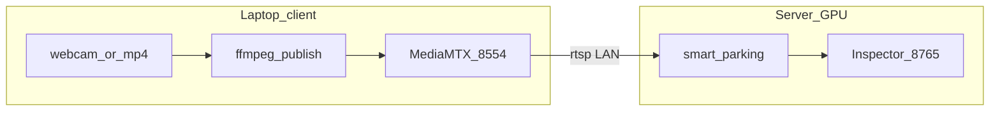

# Kịch bản B — Server GPU + Laptop client

**Server:** máy Ubuntu có NVIDIA GPU — chạy `smart_parking`, Inspector, logs.  
**Client:** laptop Ubuntu (không cần GPU) — chỉ phát **RTSP** từ **webcam** hoặc **file video có sẵn**.



---

## 0. Chuẩn bị mạng

| Máy | Việc cần làm |
|-----|----------------|
| Laptop | Biết IP LAN: `hostname -I` → ví dụ `192.168.1.50` |
| Server | Biết IP: `192.168.1.100` |
| Cả hai | Cùng Wi‑Fi/LAN; ping hai chiều |

Trên **laptop** (cho server kéo RTSP):

```bash
sudo ufw allow from 192.168.1.100 to any port 8554 proto tcp
# hoặc tạm: sudo ufw disable   # chỉ lab
```

Stream URL server sẽ dùng:

```text
rtsp://192.168.1.50:8554/parking
```

---

## 1. Laptop client — cài một lần

```bash
cd /path/to/OCR   # clone repo hoặc copy scripts/
bash scripts/setup_client.sh
sudo bash scripts/install_mediamtx_client.sh
```

Tạo cấu hình stream (copy và sửa):

```bash
sudo mkdir -p /etc/smart-parking
sudo cp configs/deploy/client-laptop.env.example /etc/smart-parking/stream.env
sudo nano /etc/smart-parking/stream.env
```

---

## 2a. B — Webcam trên laptop

```bash
# Terminal 1 — RTSP server
mediamtx

# Terminal 2 — đẩy webcam (device thường là /dev/video0)
export STREAM_ENV=/etc/smart-parking/stream.env
bash scripts/run_rtsp_publish.sh /dev/video0
```

Kiểm tra **trên laptop**:

```bash
ffprobe -rtsp_transport tcp rtsp://127.0.0.1:8554/parking
```

---

## 2b. B — Video có sẵn (MP4) trên laptop

Đặt file vào `data/parking_demo.mp4` (hoặc đường dẫn bất kỳ).

```bash
# Terminal 1
mediamtx

# Terminal 2 — lặp vô hạn file
bash scripts/run_rtsp_publish.sh /path/to/parking_demo.mp4
```

Cùng URL RTSP: `rtsp://<LAPTOP_IP>:8554/parking` — server **không phân biệt** webcam hay file.

**Lưu ý:** Calibrate slot trên server phải dùng **cùng resolution** với stream (xem `VIDEO_SIZE` trong `stream.env`).

---

## 3. Server GPU — cài và chạy

```bash
cd /opt/smart-parking   # hoặc clone OCR
bash scripts/setup_server.sh
source .venv/bin/activate
pip install torch torchvision --index-url https://download.pytorch.org/whl/cu124
pip install -e ".[inspector]"
python scripts/verify_gpu_ready.py
```

Tạo config local từ template:

```bash
cp configs/deploy/server-rtsp.yaml configs/deploy/server.local.yaml
# Sửa source: rtsp://192.168.1.50:8554/parking
# Sửa slots_path nếu đã calibrate site
```

Kiểm tra kết nối RTSP **trước** khi chạy app:

```bash
ffprobe -rtsp_transport tcp rtsp://192.168.1.50:8554/parking
```

Chạy pipeline:

```bash
export SMART_PARKING_CONFIG=configs/deploy/server.local.yaml
python -m smart_parking
```

Inspector (trên server):

```bash
curl http://127.0.0.1:8765/api/health
```

Từ máy khác (SSH tunnel):

```bash
ssh -L 8765:127.0.0.1:8765 user@192.168.1.100
# Browser: http://127.0.0.1:8765
```

---

## 4. Video có sẵn — cách thay thế (không RTSP)

Khi chỉ cần chạy thử nhanh **trên server** (không bật laptop stream):

1. Copy file từ laptop → server:

```bash
# Trên laptop
scp data/parking_demo.mp4 user@192.168.1.100:/opt/smart-parking/data/
```

2. Trên server:

```bash
cp configs/deploy/server-file-local.yaml configs/deploy/server.local.yaml
# source: data/parking_demo.mp4
python -m smart_parking --config configs/deploy/server.local.yaml
```

| Cách | Laptop | Server `source` |
|------|--------|-----------------|
| **B + RTSP** (khuyến nghị demo realtime) | `run_rtsp_publish.sh` + MediaMTX | `rtsp://LAPTOP_IP:8554/parking` |
| **File trên server** | chỉ `scp` file | `data/xxx.mp4` |

---

## 5. Script gộp (laptop)

```bash
# Webcam
bash scripts/client_laptop_start.sh webcam

# File video
bash scripts/client_laptop_start.sh video /path/to/demo.mp4
```

---

## Checklist B

| Bước | Laptop | Server |
|------|--------|--------|
| 1 | `mediamtx` chạy | `nvidia-smi` OK |
| 2 | `ffprobe` local RTSP OK | `ffprobe` tới laptop OK |
| 3 | Firewall 8554 | `verify_gpu_ready.py` OK |
| 4 | Ghi IP + resolution | `server.local.yaml` đúng `source` |
| 5 | Stream ổn định 1 phút | App chạy, `logs/events.jsonl` có dòng |

---

## Sự cố thường gặp

| Lỗi | Xử lý |
|-----|--------|
| Connection refused :8554 | Chưa chạy `mediamtx` hoặc firewall laptop |
| Server timeout RTSP | Dùng `-rtsp_transport tcp` (OpenCV/ffmpeg) |
| Slot sai vị trí | Calibrate từ frame đúng kích thước stream |
| Laptop không có `/dev/video0` | `v4l2-ctl --list-devices`; đổi device trong script |

Chi tiết chung: [DEPLOYMENT_SERVER_CLIENT.md](DEPLOYMENT_SERVER_CLIENT.md).
